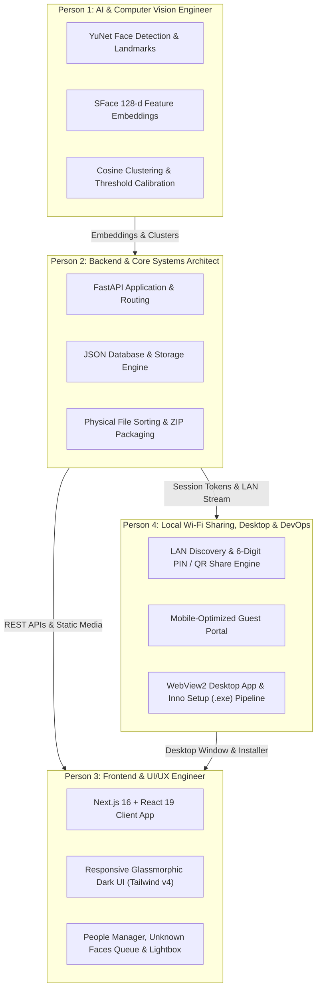
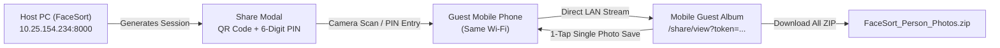

# FaceSort 🎞️

<div align="center">


**An intelligent, offline, face-recognition photo organizer and local Wi-Fi sharing suite.**  
*Every face finds its place — completely private, 100% on-device, zero cloud dependency.*

[](https://github.com/vishalkumar-09/FaceSort)
[](https://python.org)
[](https://fastapi.tiangolo.com)
[-black?logo=next.js&logoColor=white)](https://nextjs.org)
[](https://opencv.org)
[](https://github.com/vishalkumar-09/FaceSort/releases/latest)
[](LICENSE)

[⬇️ **Download Installer (.exe)**](https://github.com/vishalkumar-09/FaceSort/releases/download/v1.0.0/FaceSort-Setup-v1.0.0.exe) • [Features](#-key-features) • [Team Contributions](#-team-contribution--work-breakdown) • [Local Wi-Fi Sharing](#-local-wi-fi-qr--pin-share) • [Developer Setup](#-developer-setup) • [Build Installer](#-building-the-installer-exe)

</div>

---

## 🌟 Key Features

| Feature | Description |
| :--- | :--- |
| 🧠 **Offline Neural Face Recognition** | Powered by OpenCV's **YuNet** (deep neural face detection) and **SFace** (128-dimensional embedding model). Zero cloud calls, zero external API costs. |
| 🗂️ **Smart Unsupervised Face Clustering** | Upload photos before tagging anyone? No problem! FaceSort uses greedy cosine centroid clustering to automatically group similar faces into `Person 1/`, `Person 2/`, etc. |
| 📱 **Local Wi-Fi QR & PIN Sharing** | Share personalized photo albums with guests on the same Wi-Fi router via a dynamic **QR Code** or memorable **6-digit PIN** (e.g. `529-293`). No internet connection needed! Guests can stream galleries and 1-tap download full ZIP archives. |
| 🖥️ **Native Desktop Application** | Runs as a sleek, standalone desktop app using **Microsoft Edge WebView2** (`desktop.py`). Zero browser URL bar, native file download integration (`ALLOW_DOWNLOADS`), and minimal memory footprint. |
| 📦 **Windows `.exe` Setup Wizard** | Download and install via a standard Inno Setup Windows installer (`FaceSort-Setup-v1.0.0.exe`) with desktop shortcuts, Start Menu entry, VC++ runtime validation, and full uninstaller. |
| 🔍 **Smart Search & Filters** | Search across your entire photo library by person name, face similarity, upload dates, tags, and cluster groups. |
| 📁 **Automated Folder Organization** | One-click physical sorting into clean person-named folders (`/storage/organized/Name/`) with instant single or bulk ZIP export (`FaceSort_organized.zip`) via native Windows Save dialog. |
| ❓ **Unknown Face Identification & Auto-Rematch** | Unrecognized faces are grouped into an intuitive review queue. Assigning an unknown face extracts its 128-d embedding and instantly rematches all photos in your library. |
| 💾 **100% Offline Seed Datasets** | Bundled local sample portraits and group photos allow instant testing without needing an internet connection. |
| 🌙 **Modern Glassmorphic Dark UI** | Tailored dark & light modes built with **Next.js 16**, **Tailwind CSS v4**, **Framer Motion**, and **Lucide React**. |

---

## 👥 Team Contribution & Work Breakdown

This project is divided across **4 specialized engineering roles** for a balanced 25% distribution:



### 📋 Detailed Role & Module Breakdown

#### 👤 Person 1: AI & Computer Vision Engineer
**Primary Focus:** Deep learning models, image preprocessing, facial landmarking, and recognition algorithms.
* **Key Responsibilities:**
  * Implemented OpenCV **YuNet ONNX** model for scale-invariant face detection and 5-point facial landmark alignment.
  * Integrated **SFace ONNX** deep neural network to extract 128-dimensional L2-normalized feature vectors.
  * Designed cosine similarity comparison logic with optimal threshold calibration (`MATCH_THRESHOLD = 0.363`) to eliminate false positives.
  * Developed the greedy centroid cosine clustering algorithm for unsupervised face grouping (`cluster_faces`).
  * Built face crop extraction, EXIF image orientation auto-rotation, and thumbnail generation routines.
* **Core Modules:**
  * `backend/face_utils.py` (YuNet detection, SFace encoding & clustering)
  * `backend/models/` (`face_detection_yunet.onnx`, `face_recognition_sface.onnx`)
* **Tech Stack:** OpenCV (`cv2.FaceDetectorYN`, `cv2.FaceRecognizerSF`), NumPy, Pillow, Scikit-learn.

---

#### 👤 Person 2: Backend & Core Systems Architect
**Primary Focus:** API design, database persistence, asynchronous processing, and physical file organization.
* **Key Responsibilities:**
  * Architected the **FastAPI** server structure, modular routers, CORS middleware, and application lifecycle (`lifespan`).
  * Built the thread-safe JSON database persistence layer (`db.json`) for tracking people, photos, face coordinates, and encodings.
  * Implemented photo ingestion pipelines with size validation, UUID renaming, and static file serving.
  * Programmed the physical file sorting algorithm that organizes photos into person-named directories (`/storage/organized/<Name>/`).
  * Designed in-memory ZIP archive generation for instantaneous single-person or bulk photo exports.
  * Created the offline demo dataset router with bundled sample images.
* **Core Modules:**
  * `backend/main.py`
  * `backend/database.py`
  * `backend/config.py`
  * `backend/routers/people.py`
  * `backend/routers/photos.py`
  * `backend/routers/organize.py`
  * `backend/routers/unknown.py`
  * `backend/routers/demo.py`
* **Tech Stack:** FastAPI, Uvicorn, Python `asyncio`, `aiofiles`, `zipfile`.

---

#### 👤 Person 3: Frontend & UI/UX Engineer
**Primary Focus:** Web user interface, design system, interactive photo management, and client state.
* **Key Responsibilities:**
  * Designed the responsive, glassmorphic dark/light interface using **Next.js 16**, **React 19**, and **Tailwind CSS v4**.
  * Developed the main dashboard with live statistic cards, recent uploads carousel, and AI engine status indicators.
  * Built the interactive **Photo Gallery** featuring full-screen lightbox viewing, face tagging overlays, and EXIF metadata inspection.
  * Created the **People Manager** (profile creation, reference face upload, and photo grids) and the **Unknown Faces review queue** for fast 1-click assignments.
  * Implemented global navigation, theme switcher, toast notifications (**Sonner**), and Smart Search (⌘K modal).
* **Core Modules:**
  * `frontend/src/app/page.tsx` (Dashboard)
  * `frontend/src/app/photos/` (Photo Gallery & Lightbox)
  * `frontend/src/app/people/` (People Profiles & Face Manager)
  * `frontend/src/app/unknown/` (Unknown Faces Queue)
  * `frontend/src/app/organize/` (Folder Sorting & ZIP Downloader)
  * `frontend/src/components/` & `frontend/src/lib/api.ts`
* **Tech Stack:** Next.js (App Router), TypeScript, Tailwind CSS v4, Framer Motion, Radix UI, Lucide React.

---

#### 👤 Person 4: Local Wi-Fi Sharing, Desktop Integration & DevOps
**Primary Focus:** Offline P2P sharing, native Windows desktop wrapper, packaging, and installer automation.
* **Key Responsibilities:**
  * Created the zero-config **Local Wi-Fi Sharing** system: dynamic local IPv4 discovery, dynamic QR code generation, and 6-digit PIN token session authentication.
  * Developed the lightweight, mobile-first guest web portal (`/share/view`) allowing mobile guests to view albums and download single photos or full ZIPs over LAN without internet.
  * Integrated **PyWebView** with Microsoft Edge Chromium WebView2 engine to wrap the application as a standalone desktop window (`desktop.py`).
  * Created native Windows launch scripts (`FaceSort.bat`, `FaceSort.vbs`) for silent and terminal launching.
  * Built the automated build pipeline (`build_installer.py`) orchestrating Next.js static exports, PyInstaller bundling, and **Inno Setup 6** installer generation (`FaceSort-Setup-v1.0.0.exe`) with Visual C++ runtime verification.
* **Core Modules:**
  * `backend/routers/share.py`
  * `frontend/src/app/share/`
  * `desktop.py`
  * `build_installer.py`
  * `FaceSort.spec` & `FaceSort_Installer.iss`
  * `FaceSort.bat` & `FaceSort.vbs`
* **Tech Stack:** PyWebView (Edge WebView2), Inno Setup 6, PyInstaller, Socket LAN Discovery, QRCode.js.

---

### 📊 Contribution Matrix for Reports

| Member | Engineering Role | Key Responsibility | Work Share |
| :--- | :--- | :--- | :---: |
| **Person 1** | Machine Learning Engineer | Face detection (YuNet), feature extraction (SFace), cosine similarity matching & clustering. | **25%** |
| **Person 2** | Backend & Database Architect | FastAPI REST endpoints, JSON persistence, file uploads, folder sorting algorithm & ZIP streaming. | **25%** |
| **Person 3** | Frontend & UI/UX Developer | Next.js 16 UI, photo gallery, lightbox, people/unknown face management, dark mode design system. | **25%** |
| **Person 4** | LAN Sharing & Systems/DevOps | Wi-Fi QR/PIN share engine, mobile portal, Edge WebView2 desktop app, Inno Setup installer builder. | **25%** |

---

## 🚀 Windows Installer (Quick Start)

You don't need Python, Node.js, or Git installed to use FaceSort on Windows.

1. **Download the Installer**:
   👉 [**Download FaceSort-Setup-v1.0.0.exe (251 MB)**](https://github.com/vishalkumar-09/FaceSort/releases/download/v1.0.0/FaceSort-Setup-v1.0.0.exe) from GitHub Releases.
2. **Run Setup**:
   Double-click the downloaded setup file and follow the standard wizard (installs to `%LOCALAPPDATA%\Programs\FaceSort` or `Program Files`).
3. **Launch**:
   Double-click the **FaceSort** icon on your Desktop!

---

## 💻 1-Click Portable Desktop Launch (From Source)

If you have cloned the repository and want to run it directly as a native desktop application:

- **Option 1 (Silent)**: Double-click **`FaceSort.vbs`** (launches directly without a background console window).
- **Option 2 (Terminal)**: Double-click **`FaceSort.bat`** (launches with console logs).

Both methods start the unified FastAPI backend, serve the pre-built Next.js frontend, and open a native **1280×820** desktop window with Microsoft Edge WebView2.

---

## 📲 Local Wi-Fi QR & PIN Share

FaceSort includes an **AirDrop-style, local-first sharing system** that lets friends and family download their own photos directly to their smartphones:



1. Open any person's album on the host computer.
2. Click **"Share Album (Local Wi-Fi)"**.
3. Have your friend **scan the QR code** with their phone camera, or go to `http://<your-ip>:8000/share` and type the **6-digit PIN**.
4. The guest phone opens a lightweight, mobile-optimized gallery where they can view photos, tap into a swipeable full-screen lightbox, save individual pictures, or tap **"Download All (.ZIP)"**.

> [!TIP]
> **Phone Connection Troubleshooting:**
> - **Same Wi-Fi Network**: Both the host PC and guest smartphones must be connected to the exact same Wi-Fi router (or connect the phone directly to the Windows PC's Mobile Hotspot).
> - **Windows Firewall**: If the phone hangs on *"Connecting to local FaceSort library..."*, ensure Windows Firewall allows inbound connections for Python / Port `8000`.
> - **Router AP Isolation**: Ensure "Client Isolation" or "AP Isolation" is disabled in router settings if devices cannot communicate peer-to-peer.

---

## 🛠️ Tech Stack & Architecture

```
FaceSort Architecture
├── Frontend (Next.js 16, TypeScript, Tailwind CSS v4, Framer Motion)
│   └── Pre-rendered Static Export (HTML/CSS/JS) in `frontend/out/`
├── Backend (FastAPI, Uvicorn, Python 3.11+)
│   ├── YuNet ONNX (Face Detection: 5 facial landmarks, scale invariant)
│   ├── SFace ONNX (Face Recognition: 128-d cosine feature matching)
│   ├── Unsupervised Cosine Centroid Clustering
│   ├── JSON Database Persistence (`%LOCALAPPDATA%/FaceSort/storage/db.json`)
│   └── LAN IP Discovery & P2P ZIP Streaming
└── Desktop Packaging
    ├── PyWebView (Microsoft Edge WebView2 Desktop Framework)
    ├── PyInstaller (Single executable bundle)
    └── Inno Setup 6 (Windows Setup Wizard generator with VC++ runtime check)
```

---

## 🧑‍💻 Developer Setup

### 1. Clone the repository
```bash
git clone https://github.com/vishalkumar-09/FaceSort.git
cd FaceSort
```

### 2. Set up Backend
```powershell
cd backend
python -m venv .venv
.venv\Scripts\activate
pip install -r requirements.txt
```

> **Note**: ONNX models (`face_detection_yunet.onnx` and `face_recognition_sface.onnx`) download automatically on first run into `backend/models/`.

Run the backend server:
```powershell
python -m uvicorn main:app --host 0.0.0.0 --port 8000 --reload
```
Interactive API documentation: [http://localhost:8000/docs](http://localhost:8000/docs)

### 3. Set up Frontend
```powershell
cd ../frontend
npm install
npm run dev -- -H 0.0.0.0 -p 3000
```
Open [http://localhost:3000](http://localhost:3000) in your browser.

---

## 🔨 Building the Installer (.exe)

FaceSort includes an automated master build pipeline that turns the entire project into a redistributable Windows setup wizard:

```powershell
# From the project root (re-compiles frontend & packages installer):
python build_installer.py

# To force re-compiling the standalone PyInstaller distribution:
python build_installer.py --rebuild
```

### What this script does automatically:
1. Compiles `npm run build` in `frontend/` to generate the latest Next.js static web assets into `frontend/out/`.
2. Assembles the standalone Python runtime, FastAPI server, ONNX models, and Edge WebView2 into `dist/FaceSort/`.
3. Runs **Inno Setup Compiler** (`ISCC.exe`) to create the ultra-compressed `FaceSort-Setup-v1.0.0.exe` in `installer_output/`.

---

## 📂 Project Structure

```
FaceSort/
├── FaceSort.bat              # 1-Click Windows Batch Launcher
├── FaceSort.vbs              # 1-Click Silent Windows Launcher (no console window)
├── FaceSort.spec             # PyInstaller compilation specification
├── FaceSort_Installer.iss    # Inno Setup 6 installer script
├── build_installer.py        # Automated master installer build script
├── desktop.py                # PyWebView Edge WebView2 desktop entry point
├── README.md                 # Project documentation & team contribution breakdown
│
├── backend/
│   ├── main.py               # FastAPI server (serves API & static frontend)
│   ├── config.py             # App configuration (frozen bundle & AppData aware)
│   ├── database.py           # JSON database store & schema init
│   ├── face_utils.py         # YuNet & SFace recognition & clustering pipeline
│   ├── check_deps.py         # Runtime dependency checker
│   ├── models/               # ONNX model storage
│   ├── samples/              # Offline test portraits & group photos
│   ├── routers/
│   │   ├── people.py         # Person registration, avatars & management
│   │   ├── photos.py         # Batch photo upload & face detection
│   │   ├── organize.py       # Organize photos into person folders & ZIP
│   │   ├── unknown.py        # Unrecognized face review & assignment
│   │   ├── share.py          # Local Wi-Fi P2P sharing & PIN tokens
│   │   └── demo.py           # Offline sample seed dataset loader
│   └── requirements.txt
│
├── frontend/
│   ├── src/
│   │   ├── app/              # Next.js App Router (Static Export compatible)
│   │   │   ├── page.tsx      # Main Dashboard
│   │   │   ├── people/       # People gallery & person detail viewer
│   │   │   ├── photos/       # All photos grid & multi-select
│   │   │   ├── organize/     # Folder sorting & archive creator
│   │   │   ├── unknown/      # Unknown face clustering & assignment
│   │   │   └── share/        # Mobile guest album & PIN entry
│   │   ├── components/       # UI components (ShareModal, SearchModal, etc.)
│   │   └── lib/              # Dynamic API client & host resolution
│   ├── package.json
│   └── next.config.ts        # Static export & remote image patterns
│
└── installer_output/
    └── FaceSort-Setup-v1.0.0.exe   # Standalone Windows Installer
```

---

## 🔒 Privacy & Local-First Guarantee

- **0 Bytes to the Cloud**: All face detection, face vector extraction, clustering, and photo storage execute strictly on your local device.
- **AirDrop Security**: Local Wi-Fi share sessions stream directly peer-to-peer over your local area network (LAN) and expire automatically.
- **Biometric Safety**: Facial embeddings are stored in your own local `%LOCALAPPDATA%\FaceSort\storage\db.json` and are never transmitted over the internet.

---

## 👤 Author

**Vishal Kumar Gaud**  
- Email: [iamvishalkumar09@gmail.com](mailto:iamvishalkumar09@gmail.com)  
- GitHub: [@vishalkumar-09](https://github.com/vishalkumar-09)  
- Repository: [https://github.com/vishalkumar-09/FaceSort](https://github.com/vishalkumar-09/FaceSort)

---

## 📄 License

Distributed under the MIT License. See `LICENSE` for more information.
